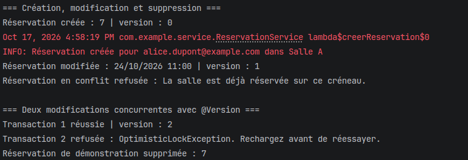

# TP8 — Réservation de salles avec JPA et Hibernate

Une réservation est créée puis modifiée, ce qui incrémente sa version. Un créneau déjà occupé est refusé. Deux modifications utilisent ensuite la même version : la première réussit et la seconde déclenche une `OptimisticLockException`. La réservation de démonstration est finalement supprimée.

Cette capture provient d'une exécution précédente et illustre les opérations toujours prises en charge par le service et vérifiées dans les tests.
